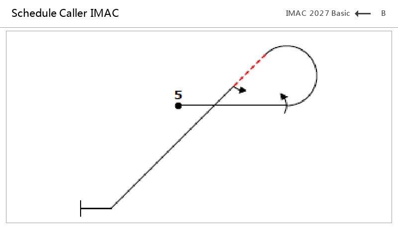
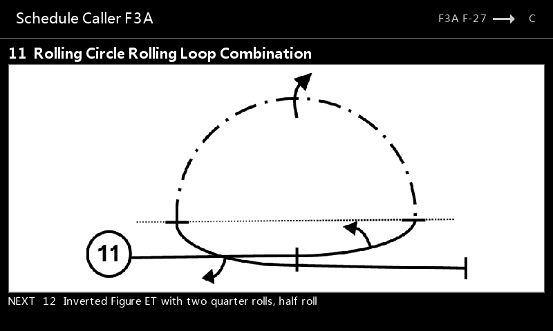
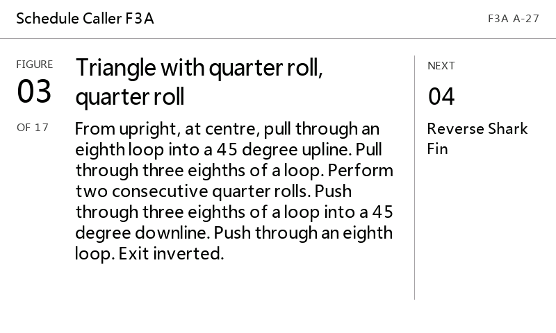
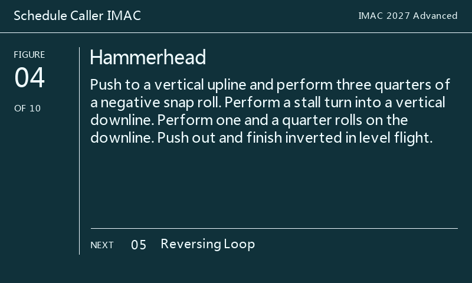
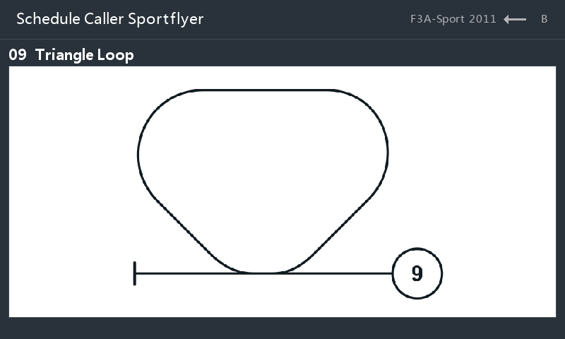

# Schedule Caller

Full-screen aerobatic practice widgets for FrSky ETHOS. Advance, repeat or restart the schedule with your assigned radio switches. Practise with full descriptions, switch to short name-only calls as you learn the sequence, or turn speech off. Choose English, Norwegian, or English names with Norwegian descriptions.

| Edition | Schedules |
| --- | --- |
| **IMAC** | IMAC 2027 Basic, Sportsman, Intermediate, Advanced and Unlimited, with Intermediate ALT, Advanced ALT and Unlimited ALT |
| **F3A** | A-27, P-27 and F-27, including their figure 10 alternatives |
| **Sportflyer** | F3A-Sport 2011 and Vingtreff |

**Version 1.0.4** uses far less Lua memory. The widget code is loaded only when a model uses Schedule Caller and is freed again when you change to a model that does not, also after you have used the widget menu. It keeps the reliable power-on and the lighter running next to the VoltDeck and GasDeck widgets from 1.0.2. Calls, audio, diagrams and settings are unchanged, and your settings carry over when you install 1.0.4 on top. [Release notes](https://github.com/bliatun-code/Schedule-Caller/releases/tag/v1.0.4)

[Installation packages](https://github.com/bliatun-code/Schedule-Caller/releases/latest) · [Illustrated setup guide](docs/Configuration.md) · [Norsk konfigurasjonsguide](docs/Konfigurasjon-norsk.md) · [Lua source](src/) · [Credits and rights](RIGHTS.md)

Tap the wind selector on the start screen to choose which diagrams the widget displays. Show the current and next manoeuvre names for a quick prompt, or hide both to give the drawing more room. The GIF shows the default view on the X20RS simulator.

<table>
<tr>
<td> <b>Dark · Diagram</b> Current and next names visible.</td>
<td> <b>Light · Briefing</b> Written instructions with a side preview.</td>
</tr>
<tr>
<td> <b>Custom · Deck</b> Your colours with a dedicated figure-number column.</td>
<td> <b>Radio theme · Diagram</b> Current name with room for the drawing.</td>
</tr>
</table>

Illustrations from IMAC (International Miniature Aerobatic Club). CIAM F3 Aerobatic drawings by Peter Uhlig. Sportflyer examples are based on the F3A-Sport 2011 schedule diagrams. [See the same figures in Light and Dark](docs/Configuration.md#light-and-dark).
