# Schedule Caller setup

The three editions use the same configuration menus. Screenshots show Schedule Caller 1.0.2 in the X20RS simulator with ETHOS 26.1.2.

[Norsk konfigurasjonsguide](Konfigurasjon-norsk.md)

## Install and open the widget

1. Download the ZIP for **IMAC**, **F3A** or **Sportflyer** from [Releases](https://github.com/bliatun-code/Schedule-Caller/releases/latest).
2. Connect your radio to FrSky Suite. Open **Lua library → Install Lua scripts** and install the selected ZIP. Allow several minutes for the larger editions and keep the radio connected until Suite finishes.
3. Restart the radio and add that edition to a **full-screen** widget area on your model.
4. Tap the widget or press the right-side centre button on the X20RS. Choose **Configure widget** from the ETHOS menu.

To update from 1.0.0, install the 1.0.2 ZIP the same way and restart the radio. Your settings carry over. **Configure widget** shows the installed version at the top.

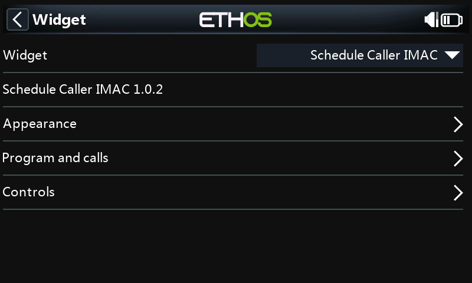

**English voice sample · Name only**. Jenny reads Half Cuban, IMAC 2027 Basic figure 5. Use the speaker icon if the player starts muted.

https://github.com/user-attachments/assets/687e81ab-eb04-4f62-b4a8-67f878b24dfe

## Appearance

Choose **Layout = Diagram** for a drawing of the current manoeuvre, or a text layout to read the description on the screen.

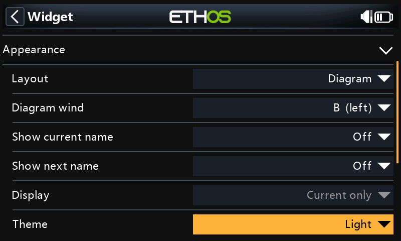

**English voice sample · Name + description**. Hear the same manoeuvre with the full call.

https://github.com/user-attachments/assets/a3b1f007-2cb7-44ef-9c10-72e0efa31b37

| Field | What it changes |
| --- | --- |
| **Layout** | **Diagram** shows the drawing. **Focus** emphasises the current manoeuvre, **Deck** gives the figure number its own column, **Daylight** emphasises contrast, and **Briefing** pairs the current text with a compact preview when enabled. |
| **Diagram wind** | **B ←** means the wind blows from right to left. **C →** means it blows from left to right. The arrow shows wind direction. Tap the wind selector on the start screen to change it there. |
| **Show current name** | Adds the current figure number and name above the drawing. Switching it off gives that space to the drawing. |
| **Show next name** | Adds a preview below the drawing. Switching it off also gives that space to the drawing. |
| **Display** | Choose **Current only** or **Current + next** in the four text layouts. |
| **Theme** | **Radio theme** follows ETHOS. **Dark** uses light text on a dark background. **Light** uses dark text on a light background. **Custom** lets you choose both colours. |

### Diagram with and without names

The same IMAC figure with both names hidden (default) and both names visible. Use either switch independently.

| Both names off | Both names on |
| --- | --- |
| 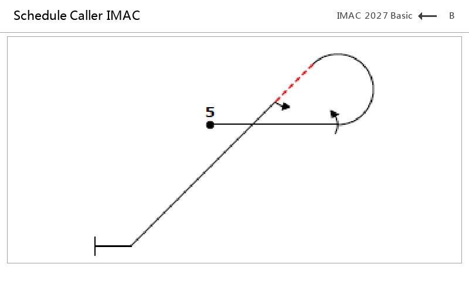 | 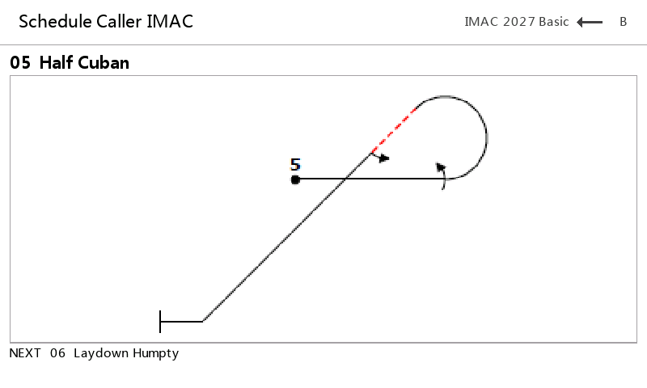 |

Illustrations from IMAC (International Miniature Aerobatic Club).

### Select the wind

Tap the wind card to switch between B and C. Match the arrow to the direction the wind is blowing. The arrow in the header shows the same choice.

| IMAC · Light | F3A · Dark |
| --- | --- |
| 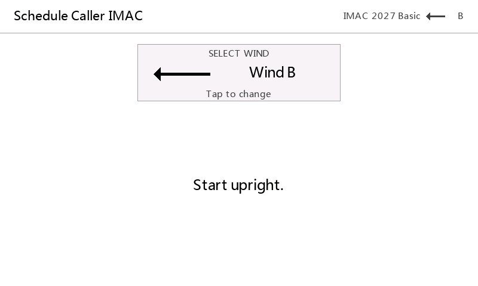 | 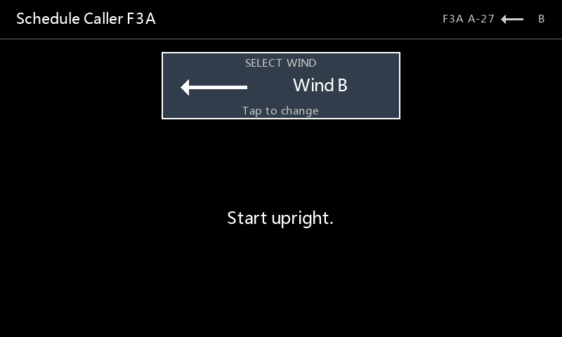 |

The two diagrams below show how the same P-27 figure changes with the wind setting.

| Wind B ← | Wind C → |
| --- | --- |
| 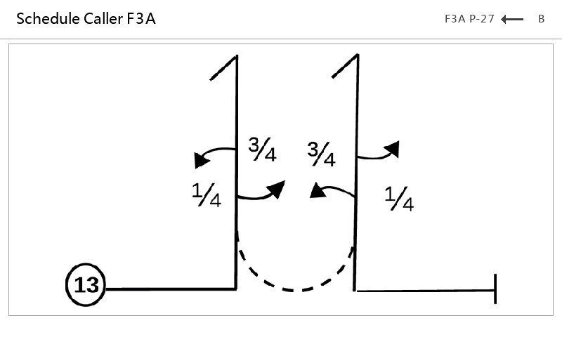 | 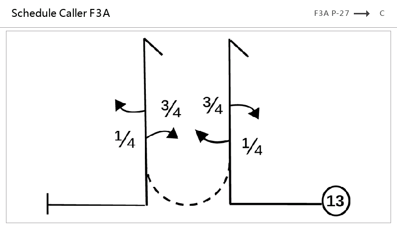 |

CIAM F3 Aerobatic drawings by Peter Uhlig.

### Light and Dark

| Edition | Light | Dark |
| --- | --- | --- |
| **IMAC** |  | 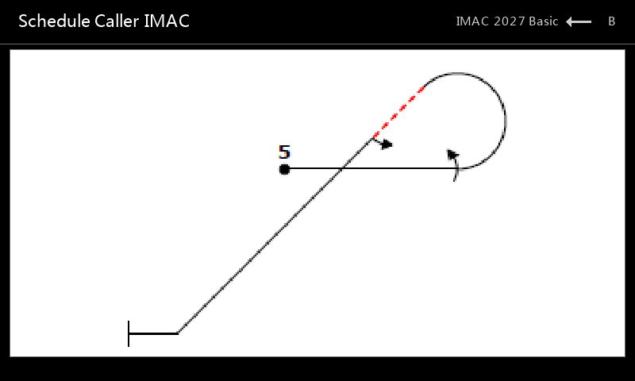 |
| **F3A** |  | 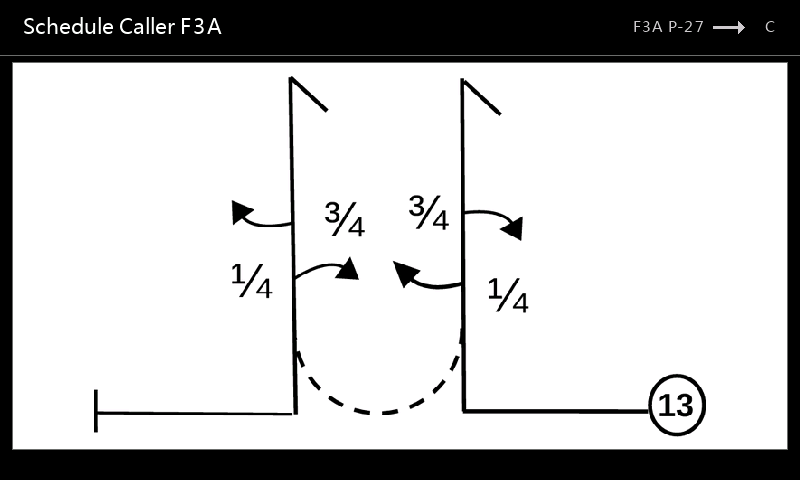 |
| **Sportflyer** | 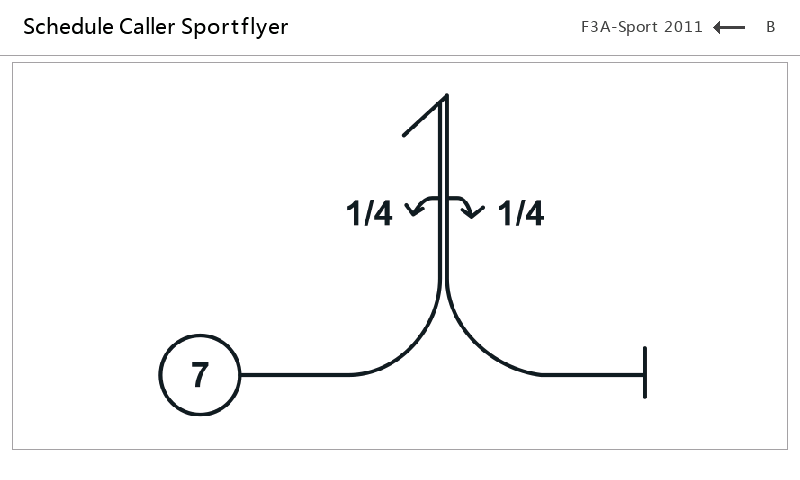 | 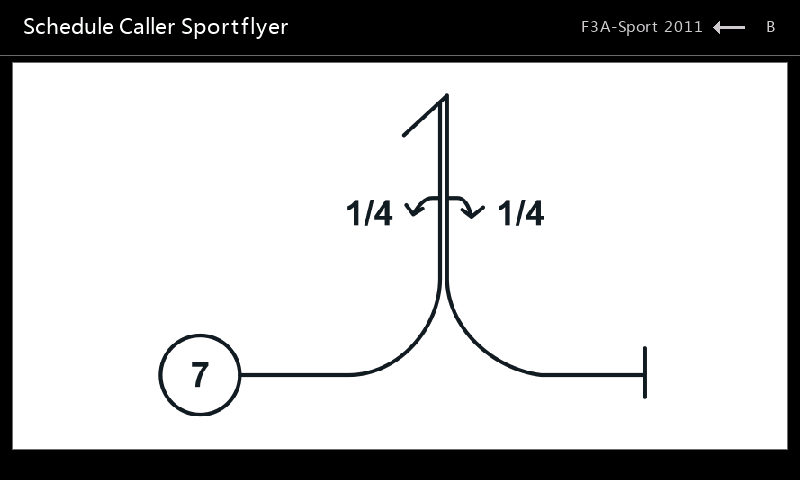 |

Illustrations from IMAC (International Miniature Aerobatic Club). CIAM F3 Aerobatic drawings by Peter Uhlig. Sportflyer example based on the F3A-Sport 2011 schedule diagrams.

### Briefing example

**Briefing** with **Display = Current + next** shows the written instructions beside the next manoeuvre. Choose **Diagram** to return to drawings.

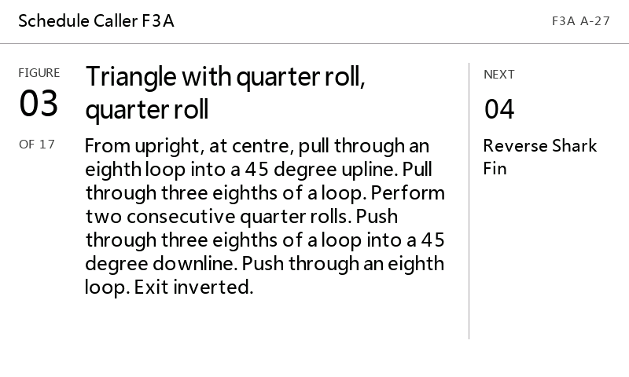

## Program and calls

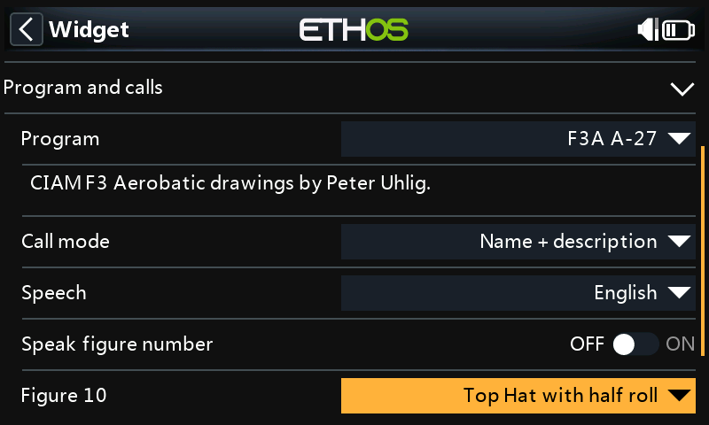

- **Program** selects a schedule in the installed edition. Where a figure has a choice, a **Figure** field selects which version the widget shows and calls. IMAC ALT schedules have their own entries under **Program**.
- **Call mode** chooses **Name only** or **Name + description**. Use the longer call while learning the schedule.
- **Speech** offers **English**, **Norwegian**, **English name + Norwegian description**, and **Off**. The written manoeuvre names stay in English. Off keeps the display and navigation available for silent practice.
- **Speak figure number** adds the figure number before the spoken manoeuvre name.

On a fresh setup the widget uses **Diagram**, **Light**, both name rows off, **Name only**, **English**, and spoken figure numbers off. An update keeps choices already saved for the pilot.

## Controls

Assign momentary controls for the active model. The examples use the switches on an X20RS.

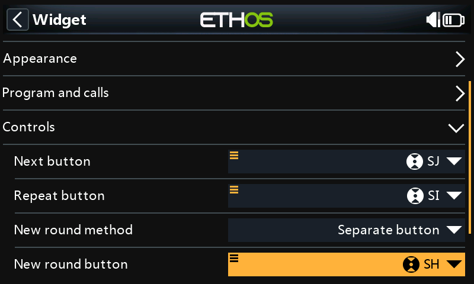

| Field or action | Example and behaviour |
| --- | --- |
| **Next button** | **SJ**. The first press calls the start instruction. Continue with the figures, then the completion message. The following press returns to the start. |
| **Repeat button** | **SI**. Press once to repeat the current call or twice quickly to go back one step. |
| **New round method** | Choose **Separate button** or **Hold Repeat**. |
| **New round button** | With **Separate button**, assign a control such as **SH**. The ETHOS widget menu also offers **New round**. |

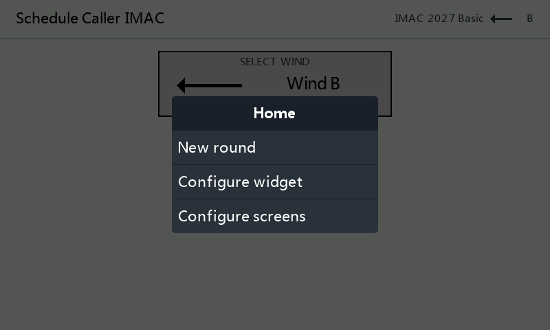
