# Oppsett av Schedule Caller

De tre utgavene har de samme menyene. Skjermbildene viser Schedule Caller 1.0.5 i X20RS-simulatoren med ETHOS 26.1.2. Menyvalgene nedenfor står med de engelske navnene du ser på radioen.

[English setup guide](Configuration.md)

## Installer og åpne widgeten

1. Last ned ZIP-filen for **IMAC**, **F3A** eller **Sportflyer** fra [Releases](https://github.com/bliatun-code/Schedule-Caller/releases/latest).
2. Koble radioen til FrSky Suite. Åpne **Lua library → Install Lua scripts** og installer ZIP-filen. Beregn noen minutter for de større utgavene, og la radioen være tilkoblet til Suite er ferdig.
3. Start radioen på nytt og legg den valgte utgaven i et widgetfelt som dekker **hele skjermen**.
4. Trykk på widgeten eller på midtknappen på høyre side av X20RS. Velg **Configure widget** i ETHOS-menyen.

Ved oppdatering fra 1.0.4, 1.0.2 eller 1.0.0 installerer du 1.0.5-ZIP-filen på samme måte og starter radioen på nytt. Innstillingene dine beholdes. Øverst i **Configure widget** ser du hvilken versjon som er installert.

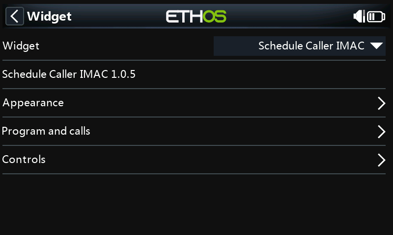

**Norsk lydprøve · Bare navn**. Iselin leser Halv kubansk åtter, figur 5 i IMAC 2027 Basic. Bruk høyttalerikonet hvis avspilleren starter uten lyd.

https://github.com/user-attachments/assets/39738de0-9b92-47c8-bacc-31b842c9f2af

## Utseende

Velg **Layout = Diagram** for å se illustrasjonen av manøveren. Velg et tekstoppsett for å lese beskrivelsen på skjermen.

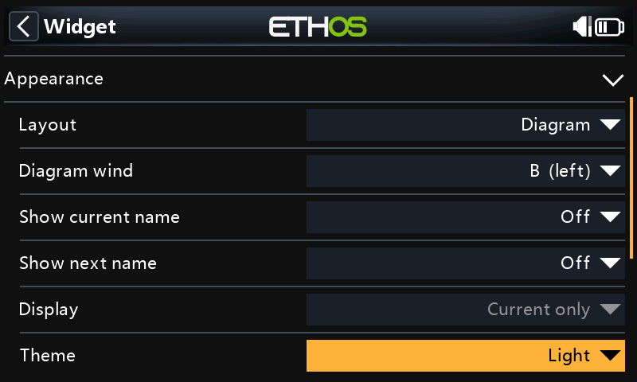

**Norsk lydprøve · Navn og beskrivelse**. Hør samme manøver med full opplesning.

https://github.com/user-attachments/assets/0b3e6a4d-4465-4946-b2cd-7762e19b70ec

| Felt | Hva det styrer |
| --- | --- |
| **Layout** | **Diagram** viser illustrasjonen. **Focus** fremhever gjeldende manøver, **Deck** gir figurnummeret en egen kolonne, **Daylight** gir tydelig kontrast, og **Briefing** kan vise gjeldende beskrivelse ved siden av en kompakt forhåndsvisning. |
| **Diagram wind** | **B ←** betyr vind fra høyre. **C →** betyr vind fra venstre. Pilen viser vindretningen. Du kan også trykke på vindvelgeren på startskjermen. |
| **Show current name** | Viser figurnummer og navn over illustrasjonen. Når du slår av raden, får illustrasjonen mer plass. |
| **Show next name** | Viser neste punkt under illustrasjonen. Når du slår av raden, får illustrasjonen mer plass. |
| **Display** | Velg **Current only** for gjeldende manøver eller **Current + next** for å ta med neste i de fire tekstoppsettene. |
| **Theme** | **Radio theme** følger ETHOS-temaet. **Dark** gir lys tekst på mørk bakgrunn, og **Light** gir mørk tekst på lys bakgrunn. Med **Custom** velger du begge fargene selv. |

### Diagram med og uten navn

Samme IMAC-figur med begge navneradene skjult som i standardoppsettet, og med begge radene synlige. Du kan slå radene av og på hver for seg.

| Begge navn av | Begge navn på |
| --- | --- |
| 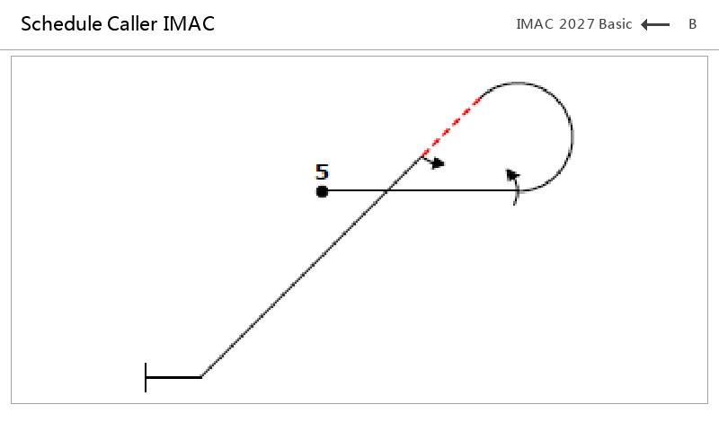 | 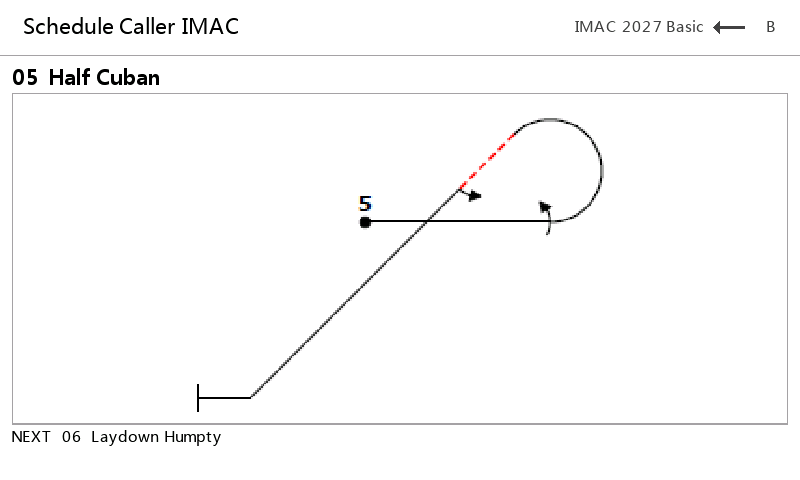 |

Illustrasjoner fra IMAC (International Miniature Aerobatic Club).

### Velg vindretning

Trykk på vindvelgeren for å veksle mellom B og C. Velg pilen som viser hvilken vei vinden blåser. Pilen i tittellinjen viser samme valg.

| IMAC · Lyst tema | F3A · Mørkt tema |
| --- | --- |
| 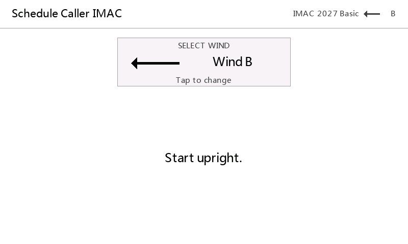 | 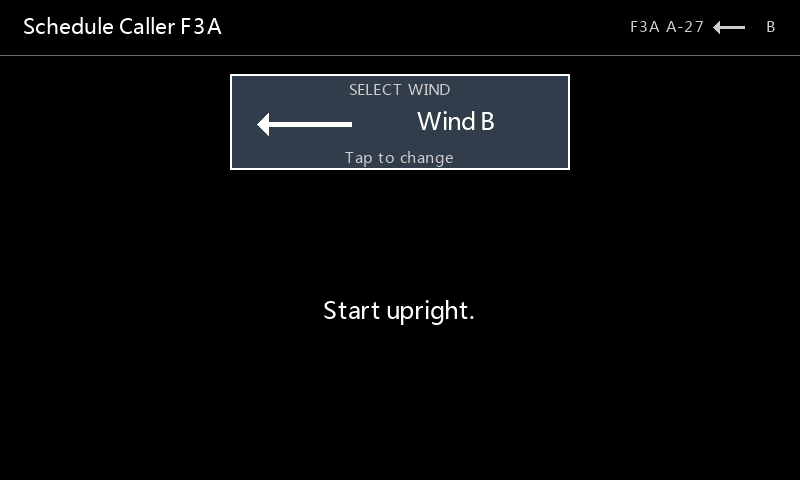 |

Bildene nedenfor viser samme P-27-figur med hver sin vindretning.

| Vind B ← | Vind C → |
| --- | --- |
| 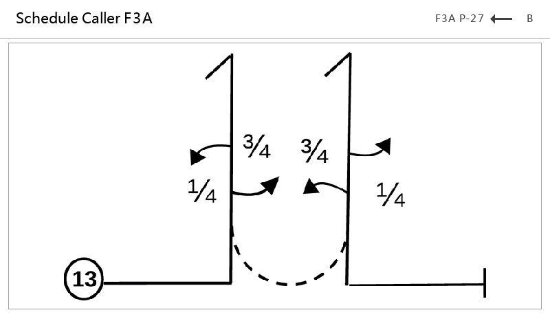 | 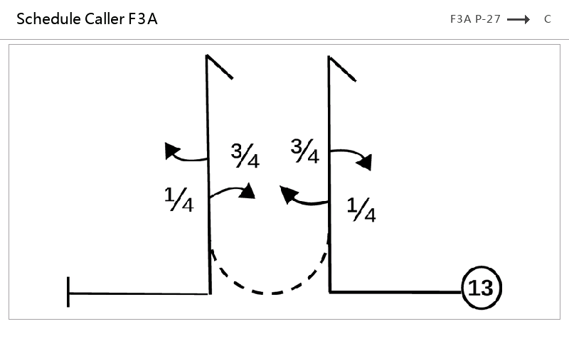 |

CIAM F3 Aerobatic drawings by Peter Uhlig.

### Lyst og mørkt tema

| Utgave | Light | Dark |
| --- | --- | --- |
| **IMAC** |  | 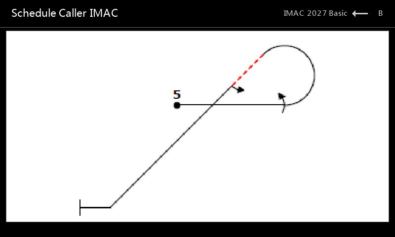 |
| **F3A** |  | 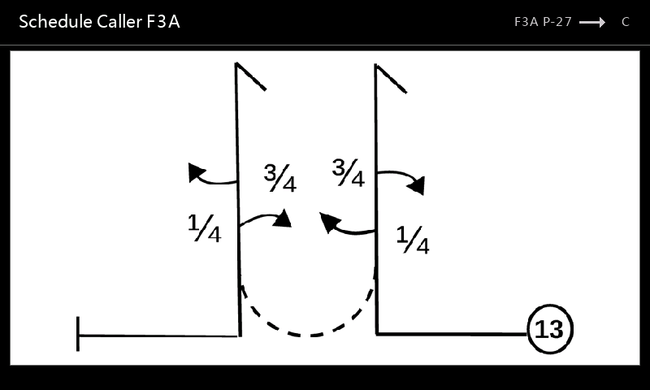 |
| **Sportflyer** | 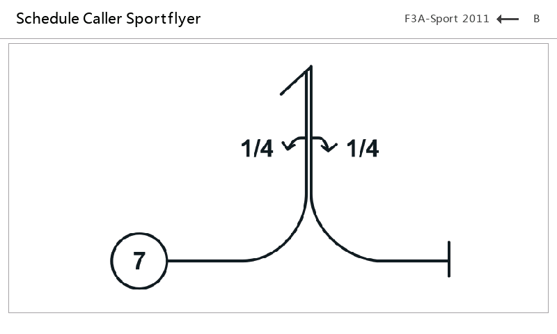 | 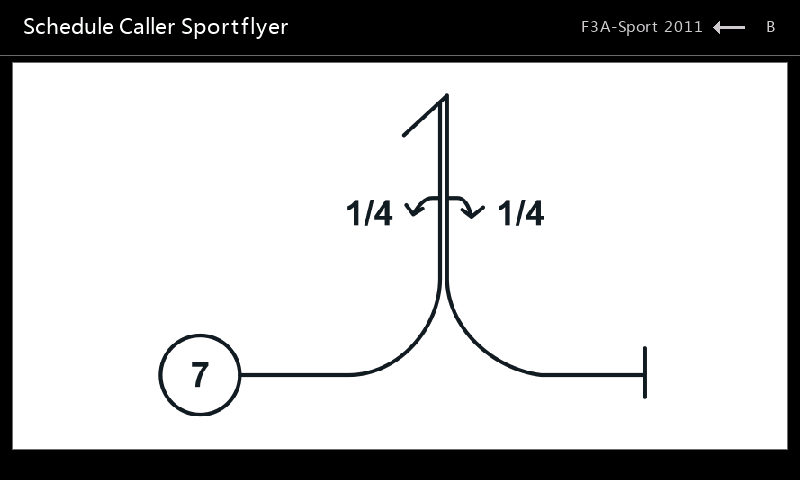 |

Illustrasjoner fra IMAC (International Miniature Aerobatic Club). CIAM F3 Aerobatic drawings by Peter Uhlig. Sportflyer-eksempelet bygger på illustrasjonene i F3A-Sport 2011-programmet.

### Eksempel med Briefing

**Briefing** med **Display = Current + next** viser beskrivelsen ved siden av neste manøver. Velg **Diagram** for å gå tilbake til illustrasjonene.

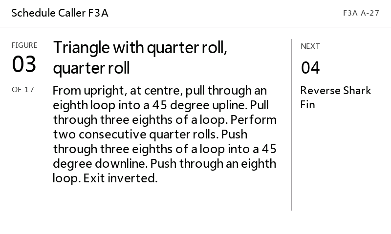

## Program og opplesning

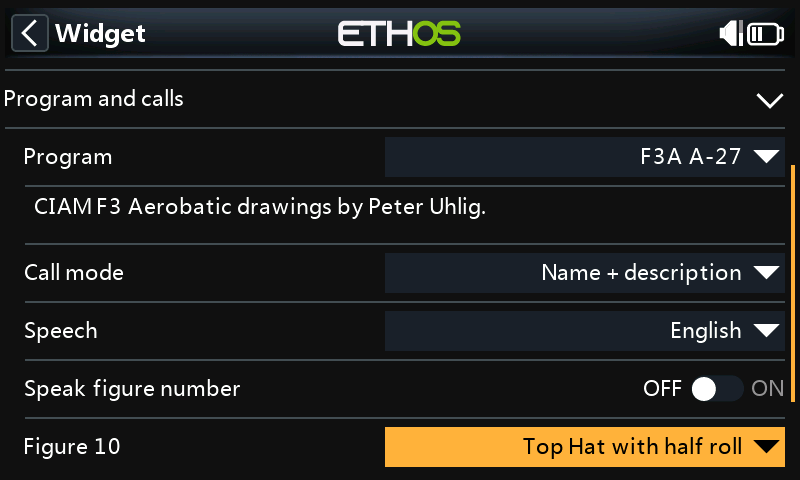

- **Program** velger et flyprogram i utgaven du har installert. Der en figur har et alternativ, velger du i det aktuelle **Figure**-feltet hvilken variant widgeten skal vise og lese opp. IMAC har egne **Program**-valg for ALT-programmene.
- **Call mode** velger **Name only** for bare navnet eller **Name + description** for navn og beskrivelse. Bruk det lengre kallet når du lærer programmet.
- **Speech** tilbyr **English** for engelsk, **Norwegian** for norsk, **English name + Norwegian description** for engelsk navn med norsk beskrivelse og **Off** for stille trening med visning og knapper. Manøvernavnene på skjermen står på engelsk.
- **Speak figure number** leser figurnummeret før manøvernavnet.

Ved første oppsett starter widgeten med **Diagram**, **Light**, begge navneradene av, **Name only**, **English** og figurnummer i talen slått av. Oppdateringer beholder valgene du har lagret.

## Knapper

Tildel momentbrytere for modellen som er aktiv. Eksemplene bruker bryterne på X20RS.

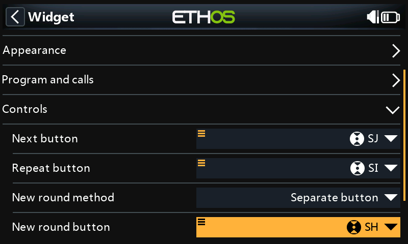

| Felt eller handling | Eksempel og funksjon |
| --- | --- |
| **Next button** | **SJ**. Første trykk leser startinstruksjonen. Fortsett gjennom manøvrene til sluttmeldingen. Neste trykk tar deg tilbake til start. |
| **Repeat button** | **SI**. Ett trykk gjentar gjeldende kall. To raske trykk går ett punkt tilbake. |
| **New round method** | Velg **Separate button** for en egen knapp eller **Hold Repeat** for å holde inne Gjenta. |
| **New round button** | Med **Separate button** kan du tildele for eksempel **SH**. Du finner også **New round** i ETHOS-menyen for widgeten. |

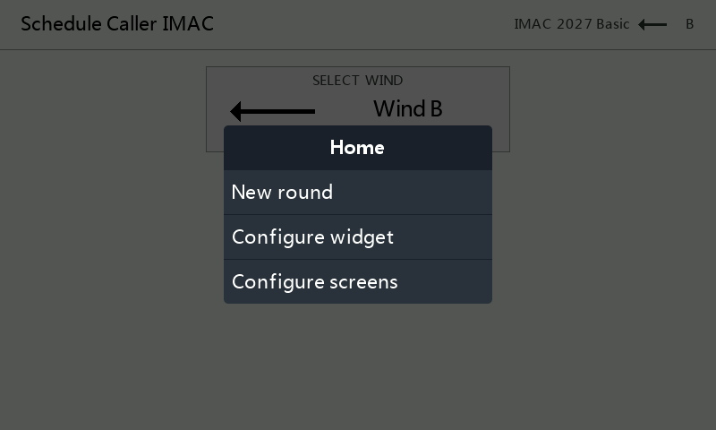
